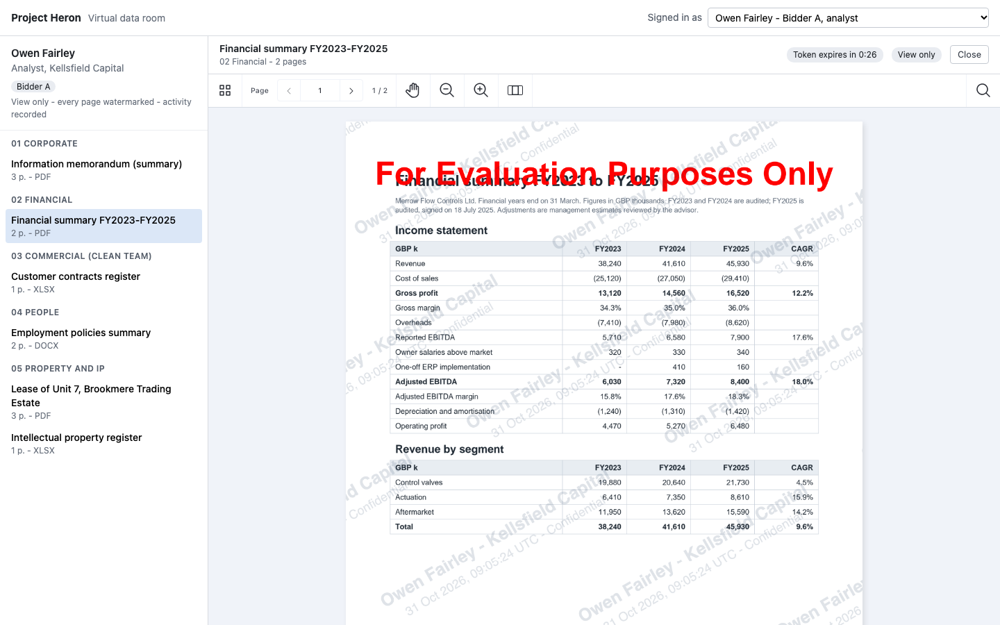
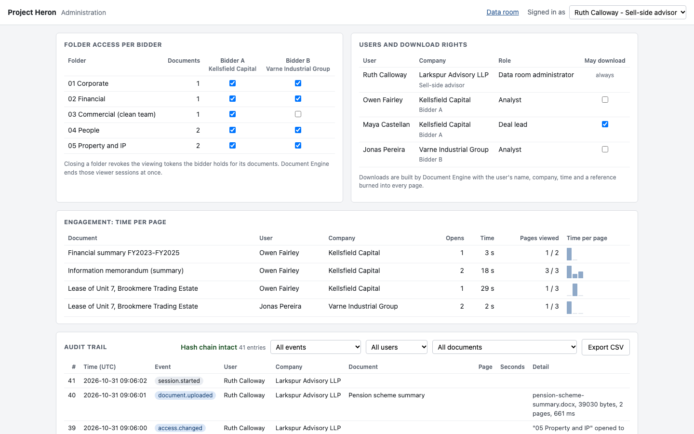
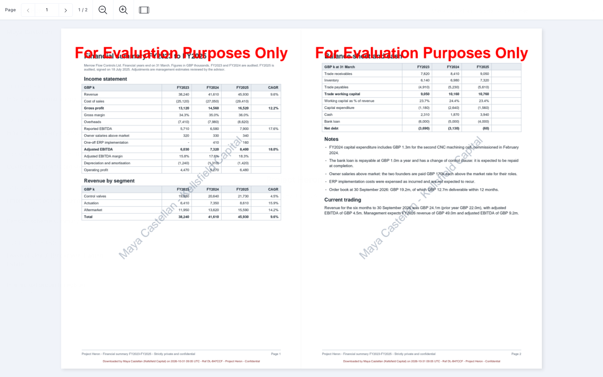

# Nutrient Secure Data Room

A Nutrient.io demo of a virtual data room for M&A due diligence: the seller's advisor publishes documents in folders, two bidder teams read them in a view-only viewer with their name on every page, and every open, page view, download and refusal is logged. It uses Nutrient Document Engine and the Nutrient Web SDK.



1. **Documents.** Document Engine stores the documents. On its first start, the Node server uploads six fictitious documents for "Project Heron", the sale of an invented valve maker. The Word and Excel files are converted to PDF by Document Engine during the upload.
2. **Access rules.** The administrator decides which bidder may open each folder, and which user may download. The server applies these rules. A bidder never sees a folder that is closed to their company.
3. **Viewing token.** To open a document, the browser asks the server for a token. If the user may open it, the server signs a JWT for that one document, with the `read` permission only (no `write`, no `download`) and a short expiry (120 s by default). Document Engine checks the signature, the document and the expiry on every request of the viewer.
4. **Locked viewer.** The Web SDK viewer opens the document in server-backed mode with that JWT. The toolbar has navigation, zoom and search only. Printing, export, text selection, forms and annotations are off. Without the `download` permission, the Web SDK refuses to turn export or printing back on, and Document Engine refuses to send the PDF.
5. **Watermark on screen.** `renderPageCallback` draws the viewer's name, company and the current date and time (UTC) across every page, and a line at the foot of the page.
6. **Expiry and revocation.** When the token expires, the viewer closes and the user asks for a new one; the server checks the access again first. When the administrator closes a folder to a bidder, the server revokes the bidder's open tokens with the Document Engine `/api/revoke` endpoint, and their viewers stop at once.
7. **Watermarked download.** Users with the download right get a copy built by the Document Engine Build API: `watermark` actions with the name, company, time and a download reference, then `flatten`, so the watermark is part of the page content.
8. **Audit trail.** The server logs sign-ins, opens, time per page, closes, expiries, renewals, downloads, refusals and administrator changes in `data/audit.jsonl`. Each entry carries the SHA-256 of the previous one. The administration page shows the log, the time spent on each page per user, and exports CSV.

## Users and access

All people and companies are fictitious. The demo has no real sign-in: pick a user in the top bar.

| User | Company | Role | Download |
|---|---|---|---|
| Ruth Calloway | Larkspur Advisory LLP | Sell-side advisor, data room administrator | Yes |
| Owen Fairley | Kellsfield Capital | Bidder A, analyst | No |
| Maya Castellan | Kellsfield Capital | Bidder A, deal lead | Yes |
| Jonas Pereira | Varne Industrial Group | Bidder B, analyst | No |

| Folder | Documents | Bidder A | Bidder B |
|---|---|---|---|
| 01 Corporate | Information memorandum (PDF, 3 pages) | Yes | Yes |
| 02 Financial | Financial summary FY2023-FY2025 (PDF, 2 pages) | Yes | Yes |
| 03 Commercial (clean team) | Customer contracts register (Excel) | Yes | No |
| 04 People | Employment policies summary (Word) | Yes | Yes |
| 05 Property and IP | Lease (PDF, 3 pages), intellectual property register (Excel) | Yes | Yes |

Bidder B is a trade buyer and a competitor of the target, so the commercial folder is for Bidder A's clean team only. The administrator can change any of this on the administration page. The defaults are in `server/data-room.js`.

## What is enforced where

| Control | Enforced by |
|---|---|
| Which folders and documents a user may open | Node server: no token for a closed folder (HTTP 403, logged) |
| A token opens one document only | Document Engine: `allowed_documents` in the JWT ("Document is forbidden" for any other document) |
| Tokens expire | Document Engine: every request is checked against `exp`, including requests of a viewer that is already open |
| Withdrawn access ends open viewers | Document Engine: `/api/revoke` destroys the sessions opened with the revoked JWTs |
| No annotations, no PDF export or print | Document Engine: no `write` and no `download` permission. The Web SDK also refuses to re-enable export or printing |
| Who may download | Node server: download right and folder access checked on each request |
| Burned-in download watermark | Document Engine Build API, flattened into the page content |
| No text selection, no print or save shortcut, no context menu | Browser only (`disableTextSelection`, key and print CSS handlers) |
| Watermark on screen | Browser only (`renderPageCallback`) |
| Time per page | Measured by the browser, recorded by the server |

## Prerequisites

- Docker Desktop with at least 4 GB of memory
- Node.js 22 or later and npm
- OpenSSL and a POSIX shell, to generate the local keys (on Windows, use Git Bash or WSL)
- Free ports 4720 (app) and 5720 (Document Engine), or other ports set in `.env`
- Internet access: the browser loads Nutrient Web SDK 1.24.0 from the Nutrient CDN
- For the tests: Playwright's Chromium (`npx playwright install chromium`). Tesseract OCR is optional
- Python 3.10 or later, only to regenerate the samples

## Environment variables

Copy `.env.example` to `.env`. Docker Compose and the Node server read it. License keys are only read from environment variables, never from code.

| Variable | Purpose | Default |
|---|---|---|
| `ACTIVATION_KEY` | Document Engine activation key or offline license key | empty = evaluation mode |
| `WEB_SDK_LICENSE_KEY` | Web SDK license key, sent to the browser with the viewing token | empty = evaluation mode |
| `POSTGRES_PASSWORD` | Local PostgreSQL password used by Document Engine | `change-me`, change it |
| `DASHBOARD_PASSWORD` | Document Engine dashboard password (<http://localhost:5720/dashboard>, user `dashboard`) | `change-me`, change it |
| `APP_PORT` | Port of the Node server | `4720` |
| `DOCUMENT_ENGINE_PORT` | Host port of Document Engine. The browser loads the pages from it | `5720` |
| `VIEWER_TOKEN_TTL_SECONDS` | Lifetime of a viewing token | `120` |
| `DE_URL`, `DE_EXTERNAL_URL` | Document Engine URL for the server and for the browser, if not `http://localhost:<DOCUMENT_ENGINE_PORT>` | empty |
| `DATA_DIR` | Folder for `state.json` and `audit.jsonl` | `data` |
| `JWT_PRIVATE_KEY_PATH` | Key that signs the viewing tokens | `keys/jwt-private.pem` |

In evaluation mode, Document Engine stamps "For Evaluation Purposes Only" on every page, including the converted Office files and the downloads. It also limits files to 50 MB and processing steps to 100 s. Everything else works.

`scripts/generate-keys.sh` writes the other secrets to `keys/`, which is not committed:

| File | Content |
|---|---|
| `keys/jwt-private.pem` | RSA key the server uses to sign the viewing tokens |
| `keys/jwt-public.pem` | Matching public key |
| `keys/document-engine.env` | `JWT_PUBLIC_KEY`, `API_AUTH_TOKEN` and `SECRET_KEY_BASE` for Document Engine |
| `keys/app.env` | `DE_API_TOKEN` (the same value as `API_AUTH_TOKEN`) and `SESSION_SECRET`, which signs the demo sign-in cookie |

## Build and run

```bash
cp .env.example .env
```

```bash
./scripts/generate-keys.sh
```

```bash
docker compose up -d
```

```bash
cd server
```

```bash
npm install
```

```bash
npm start
```

Open <http://localhost:4720>. On its first start, the server uploads the documents in `samples/documents/` to Document Engine. The administration page is <http://localhost:4720/admin.html>.

To stop and remove the containers and the documents:

```bash
docker compose down -v
```

The folder access, download rights and audit trail are kept in `data/`. Delete it to start again from the defaults.

## Using the app

1. **Pick a user** in the top bar. The left panel lists the folders open to that user's company.
2. **Open a document.** The top of the viewer shows the token countdown and "View only", or a **Download watermarked PDF** button for users with the download right. Every page shows the user's name, company and the time. The print and save shortcuts show a notice instead.
3. **Let the token expire.** At zero the viewer closes. **Request a new token** opens the document again on the same page if the user still has access. Set `VIEWER_TOKEN_TTL_SECONDS=30` in `.env` to see it sooner.
4. **Withdraw access live.** Open the lease as Jonas Pereira (Bidder B) in one browser. In another browser, sign in as Ruth Calloway, open **Administration** and untick Bidder B for "05 Property and IP". As soon as Jonas's viewer needs another page, it shows "Access withdrawn" and the folder disappears from his list.
5. **Download.** As Maya Castellan, click **Download watermarked PDF**. The file name and every page carry a reference such as `DL-6CAFAF`, which is also in the audit trail.
6. **Review the activity.** As Ruth Calloway, open **Administration**: folder access per bidder, download rights, the time each user spent on each page, and the audit trail with filters and **Export CSV**. Uploads of PDF, Word, Excel and PowerPoint files go to the folder you pick.

   

A downloaded copy, opened in a PDF viewer: the name and company run across each page and the download line sits at the foot of each page.



## Tests

`tests/e2e.mjs` starts its own server on port 4721 with 30-second tokens and an empty data folder, then runs the checks with Playwright, `fetch` and pdf.js. Document Engine must be running.

```bash
cd tests
```

```bash
npm install
```

```bash
npx playwright install chromium
```

```bash
npm test
```

`npm run screenshots` also writes `docs/screenshots/`. Results of the last run (all 41 checks passed):

| Check | Result |
|---|---|
| Bidder B asks for a token for the clean team document | HTTP 403, logged with the reason |
| Bidder B's token used for another document | Document Engine: HTTP 403 "Document is forbidden" |
| Viewing token claims | one document, `["read"]`, `exp - iat` = token lifetime |
| Toolbar | sidebar-thumbnails, pager, pan, zoom-out, zoom-in, zoom-mode, spacer, search |
| `setViewState` with `allowExport: true`, `exportPDF()`, `print()` | all refused |
| Drag over the text | nothing selected |
| Watermark on screen | drawn on each rendered page; 5,879 pixels of the foot line found in the page images; the line read back by OCR |
| Time per page (4 s, 3 s, 5 s spent) | 4.0 s, 3.0 s, 5.1 s recorded |
| Token expiry | viewer closed 0.3 s after `exp`; Document Engine: HTTP 403 "Token has expired"; renewal back on the same page |
| Folder closed to Bidder B while reading | 1 token revoked; viewer showed "Access withdrawn" 56 ms after the change; Document Engine: HTTP 403 "Token has been revoked" |
| Analysts download | HTTP 403, logged |
| Deal lead downloads (2 pages) | built in 187 ms; both pages contain the name, company and reference as text; 0 annotations left |
| Administrator uploads a Word file | converted by Document Engine in about 0.5 s, listed for the bidders |
| Audit trail | hash chain intact; CSV has one row per entry |

## API

All routes except `/api/users`, `/api/session` and `/api/me` need the sign-in cookie. `/api/admin/*` is for the administrator only.

| Method and path | Description |
|---|---|
| `GET /api/users` | The demo users |
| `POST /api/session` | `{ userId }`. Demo sign-in: sets a signed cookie |
| `GET /api/me` | The signed-in user, or `null` |
| `GET /api/room` | Folders and documents open to the user |
| `POST /api/documents/:id/viewer-token` | `{ reason: "open" or "renew" }`. Returns the JWT, its expiry, the Document Engine URL and the download right. 403 if the folder is closed to the user |
| `POST /api/activity` | `{ tokenId, pages: [{ page, seconds }], closed }`. Time per page and close reason, from the viewer |
| `GET /api/documents/:id/download` | Watermarked PDF built by Document Engine. Header `X-Download-Reference` |
| `GET /api/admin/state` | Folders with access per bidder, users with download rights |
| `PUT /api/admin/folders/:id/access` | `{ company, allowed }`. Closing a folder revokes the bidder's open tokens for it |
| `PUT /api/admin/users/:id/download` | `{ allowed }` |
| `POST /api/admin/documents?folder=&name=&title=` | Raw file body (PDF, Word, Excel, PowerPoint). Uploads it to Document Engine |
| `GET /api/admin/audit?event=&user=&document=` | Audit entries, newest first, and the hash chain check |
| `GET /api/admin/audit.csv` | The same entries as CSV |
| `GET /api/admin/engagement` | Opens and time per page, per document and user |

## Samples

`samples/documents/` holds six fictitious documents for Project Heron: an information memorandum, a financial summary, a lease summary (PDF), employment policies (Word), a customer contracts register and an intellectual property register (Excel). Every company, person, address and figure is invented. To regenerate them:

```bash
pip install -r samples/requirements.txt
```

```bash
python samples/generate_samples.py
```

Then run `docker compose down -v` and delete `data/` so that the server uploads the new versions.

## Limitations

- **Screenshots and photos.** The on-screen watermark deters them and shows who leaked a page, but it does not prevent them. It is drawn in the browser on top of clean page images from Document Engine, so a technical user can remove it with the browser's developer tools. Downloads carry a watermark that is part of the PDF.
- **Text.** Text selection is off in the viewer, but the `read` permission lets the viewer load the page text for search, so a technical user with the session token could still fetch it.
- **Sign-in.** The user picker stands in for real authentication (SSO, multi-factor). Anyone can pick the administrator.
- **Audit trail.** The hash chain shows edits and deletions, but someone with write access to `data/audit.jsonl` could rewrite the whole chain. A production system would write to append-only storage or publish the last hash elsewhere. Time per page is measured by the browser, so a modified browser could report other values.
- **Token renewal.** The user clicks to get a new token, to make the expiry visible. A production data room would renew in the background with `instance.setSession()` while the user is active, and keep the server-side access check.
- **One process.** The list of open tokens, used for revocation, is kept in memory. After a restart, tokens issued before it can no longer be revoked; they still expire.

## Files

| Path | Content |
|---|---|
| `server/server.js` | Access rules, viewing tokens, downloads, revocation, administration API |
| `server/document-engine.js` | Upload, Build API watermark, JWT revocation |
| `server/audit.js` | Hash-chained audit trail, CSV export, time per page |
| `server/data-room.js` | Users, companies, folders and the default access |
| `web/` | Data room page with the Web SDK viewer, and the administration page |
| `tests/e2e.mjs` | End-to-end checks and screenshots |
| `docker-compose.yml` | Document Engine 1.20.0 and PostgreSQL |
| `scripts/generate-keys.sh` | JWT key pair, API token and cookie secret for the local setup |
| `samples/` | Sample documents and their generator |
